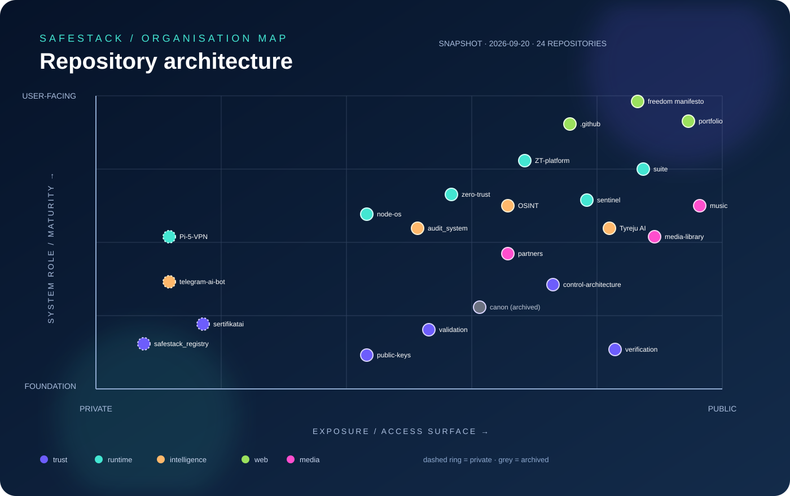
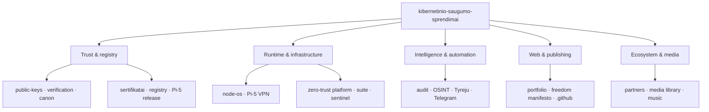

  

  
  
  

# SafeStack Repository Map

An independent visual map of the `kibernetinio-saugumo-sprendimai` GitHub organisation. It turns the repository collection into a readable architecture: foundations at the bottom, user-facing surfaces at the top, and public exposure increasing from left to right.

## How to read the map

- **X axis:** access exposure, from private to public.
- **Y axis:** system role, from trust foundations to user-facing surfaces.
- **Colour:** the repository domain shown in the legend.
- **Grey node:** archived or historical material.

The chart is a current snapshot, not a runtime dependency graph. A line indicates an architectural relationship or trust flow, not an automatic software dependency.

## Repository groups

| Group | Role | Repositories |
| --- | --- | ---: |
| Trust & registry | Keys, certificates, manifests, validation | 7 |
| Runtime & infrastructure | Devices, operating systems, zero trust | 7 |
| Intelligence & automation | Audit, OSINT, AI and bots | 4 |
| Web & publishing | Public sites and organisation configuration | 3 |
| Ecosystem & media | Partners, images and music links | 3 |

## Detailed tree

The readable hierarchy is in [REPOSITORY_TREE.md](REPOSITORY_TREE.md). The machine-readable source snapshot is in [REPOSITORY_SNAPSHOT.json](REPOSITORY_SNAPSHOT.json).

## Snapshot rules

The snapshot records repository names, visibility, role, status, and primary language as observed on 2026-09-20. It contains no secrets, customer records, private keys, or registry contents. Refresh the snapshot after a repository is created, archived, renamed, or changes visibility.

## Scope

This map is a documentation and orientation layer. It does not grant access to private repositories and does not replace each repository's own security policy, licence, or operational documentation.
