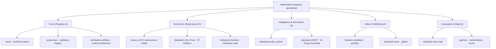

  

  
  
  

# SafeStack Public Repository Map

An independent visual architecture map of the public repositories across the `kibernetinio-saugumo-sprendimai` GitHub organisation. It organizes all public SafeStack projects into a coherent architectural topology: foundational root anchors at the bottom, user-facing surfaces at the top, and public exposure surfaces along the horizontal axis.

> **Scope Notice:** All private and internal operational repositories are strictly excluded from this map.

---

## How to read the map

- **X axis (Horizontal):** Architectural exposure surface, from foundation core to public edge.
- **Y axis (Vertical):** System layer, from root anchors to user interfaces.
- **Node Colour:** Functional domain (Trust, Runtime, Intelligence, Web, Ecosystem).
- **Grey node:** Archived canonical foundation (`safestack-canon`).

---

## Repository groups

| Group | Role | Public Repositories |
| :--- | :--- | :---: |
| **Trust & registry** | Keys, canons, manifests, checksums, control boundaries | 6 |
| **Runtime & infrastructure** | Autonomous node OS, zero trust policy engine, sentinel, suite | 5 |
| **Intelligence & automation** | Deterministic audit engine, verified OSINT, AI team tooling | 3 |
| **Web & publishing** | Freedom manifesto, portfolio, documentation library, organisation config | 4 |
| **Ecosystem & meta** | Repository map, security partners, media library, soundtrack | 4 |
| **Total Public Ecosystem** | | **22** |

---

## Detailed Tree & Machine-Readable Snapshot

- Complete readable catalogue: [REPOSITORY_TREE.md](REPOSITORY_TREE.md)
- Machine-readable JSON snapshot: [REPOSITORY_SNAPSHOT.json](REPOSITORY_SNAPSHOT.json)

---

## Snapshot Governance

The snapshot records all public repository names, architectural domains, statuses, and primary languages as verified on **2026-09-24**. It contains no confidential data, customer records, or private keys. The map is refreshed whenever public repositories are created, archived, or restructured.
