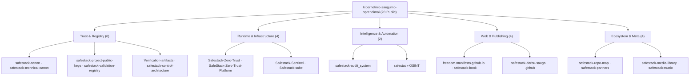

<p align="center">
  
</p>

<p align="center">
  <a href="REPOSITORY_TREE.md"></a>
  <a href="REPOSITORY_SNAPSHOT.json"></a>
  <a href="SHA256SUMS"></a>
  <a href="https://github.com/kibernetinio-saugumo-sprendimai"></a>
</p>

# SafeStack Public Repository Map

An independent visual architecture map of the public repositories across the [`kibernetinio-saugumo-sprendimai`](https://github.com/kibernetinio-saugumo-sprendimai) GitHub organisation. It organizes all public SafeStack projects into a coherent architectural topology: foundational root anchors at the bottom, user-facing surfaces at the top, and public exposure surfaces along the horizontal axis.

> **Scope Notice:** All private and internal operational repositories are strictly excluded from this map.

---

## How to read the map

- **X axis (Horizontal):** Architectural exposure surface, from foundation core to public edge.
- **Y axis (Vertical):** System layer, from root anchors to user interfaces.
- **Node Colour:** Functional domain (Trust, Runtime, Intelligence, Web, Ecosystem).
- **Grey node:** Archived canonical foundation (`safestack-canon`).

---

## Repository groups

| Group | Role | Public Repositories |
| :--- | :--- | :---: |
| **Trust & registry** | Keys, canons, owner-signed manifests, checksums, control boundaries | 6 |
| **Runtime & infrastructure** | Zero-trust policy engine, platform orchestration, sentinel, runtime suite | 4 |
| **Intelligence & automation** | Deterministic security audit framework and verified OSINT | 2 |
| **Web & publishing** | Freedom manifesto, technical library, OHS/DSS standard, organisation config | 4 |
| **Ecosystem & meta** | Repository map, security partners, media library, soundtrack | 4 |
| **Total Public Ecosystem** | | **20** |

---

## Detailed Tree & Machine-Readable Snapshot

- Complete readable catalogue: [REPOSITORY_TREE.md](REPOSITORY_TREE.md)
- Machine-readable JSON snapshot: [REPOSITORY_SNAPSHOT.json](REPOSITORY_SNAPSHOT.json)
- Repository SHA-256 manifest & owner signature: [SHA256SUMS](SHA256SUMS) · [SHA256SUMS.sig](SHA256SUMS.sig)



---

## Snapshot Governance & Cryptographic Verification

The snapshot records all **20** public repository names, architectural domains, statuses, and primary languages as verified on **2026-11-06**. It contains no confidential data, customer records, private repository references, or private keys. The map is refreshed whenever public repositories are created, archived, or change visibility.

`SHA256SUMS` is cryptographically signed (`SHA256SUMS.sig`) by the SafeStack Organization Owner (`safestack-owner`, OpenSSH Ed25519 key `SHA256:jpM7K4+8hyAJo9qg4ISDbljuENZzx2UqMHu73+S9q48`, published in [`Verification-artifacts/keys/allowed_signers`](https://github.com/kibernetinio-saugumo-sprendimai/Verification-artifacts/blob/main/keys/allowed_signers)):

```bash
shasum -a 256 -c SHA256SUMS

ssh-keygen -Y verify -f ../Verification-artifacts/keys/allowed_signers \
  -I safestack-owner -n file -s SHA256SUMS.sig < SHA256SUMS
```
