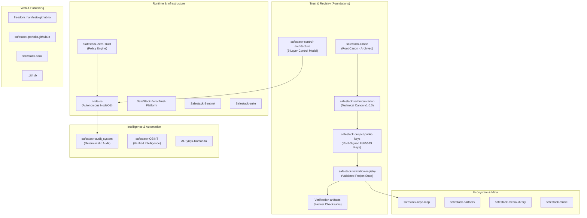

# SafeStack Public Repository Tree

Snapshot date: **2026-09-24**  
Organisation: [`kibernetinio-saugumo-sprendimai`](https://github.com/kibernetinio-saugumo-sprendimai)  
Scope: **Public Repositories Only** (Private and internal operational repositories excluded)

```text
kibernetinio-saugumo-sprendimai/
├── Trust & registry
│   ├── safestack-canon                   public · archived · canonical trust anchors & root philosophy
│   ├── safestack-technical-canon         public · active   · technical governance & manifest schemas
│   ├── safestack-project-public-keys     public · active   · signed Ed25519 project & release keys
│   ├── safestack-validation-registry     public · active   · formal validation records & audit declarations
│   ├── Verification-artifacts            public · active   · detached factual cryptographic checksum manifests
│   └── safestack-control-architecture    public · active   · 5-layer routing, encryption & trust boundaries
│
├── Runtime & infrastructure
│   ├── node-os                           public · active   · autonomous zero-trust Pi 5 edge node OS
│   ├── Safestack-Zero-Trust              public · active   · local-first policy engine & posture gates
│   ├── SafeStack-Zero-Trust-Platform     public · active   · zero-trust platform & orchestration components
│   ├── Safestack-Sentinel                public · active   · continuous node monitoring & telemetry daemon
│   └── Safestack-suite                   public · active   · integrated runtime security & crypto tools
│
├── Intelligence & automation
│   ├── safestack-audit_system            public · active   · deterministic AI-first audit framework
│   ├── safestack-OSINT                   public · active   · modular policy-driven OSINT with root verification
│   └── AI-Tyreju-Komanda                 public · active   · AI investigative tooling & collaborative workspace
│
├── Web & publishing
│   ├── freedom.manifesto.github.io       public · active   · public freedom manifesto & community documentation
│   ├── safestack-porfolio.github.io      public · active   · portfolio & architectural showcase portal
│   ├── safestack-book                    public · active   · technical books, papers & documentation library
│   └── .github                           public · active   · shared organisation profiles & workflow defaults
│
└── Ecosystem & meta
    ├── safestack-repo-map                public · active   · visual architecture map & repository registry
    ├── safestack-partners                public · active   · partner ecosystem & security integrations
    ├── safestack-media-library           public · active   · visual assets, schematics & documentation media
    └── safestack-music                   public · active   · audio link catalogue & soundtrack archive
```

---

## Architectural Trust Flow



---

## Public Repository Catalogue

| Repository | Domain | Language | Status | Primary Purpose |
| :--- | :--- | :--- | :--- | :--- |
| **`safestack-canon`** | Trust & registry | Markdown / PGP | Archived | Immutable root trust anchors and canonical philosophy |
| **`safestack-technical-canon`** | Trust & registry | JSON / PGP | Active | Technical specifications, manifest schemas, and hash registry |
| **`safestack-project-public-keys`**| Trust & registry | Python / Ed25519 | Active | Root-signed project public keys and release signer registry |
| **`safestack-validation-registry`**| Trust & registry | JSON / PGP | Active | Formal registry of validated projects, audit records, and declarations |
| **`Verification-artifacts`** | Trust & registry | Shell / SHA-256 | Active | Detached cryptographic checksum manifests for external audit |
| **`safestack-control-architecture`**| Trust & registry | HTML / CSS | Active | Layered routing, encryption mechanisms, and infrastructure boundaries |
| **`node-os`** | Runtime & infra | Go | Active | Autonomous zero-trust edge node OS for Raspberry Pi 5 |
| **`Safestack-Zero-Trust`** | Runtime & infra | Python | Active | Local-first zero trust policy decision engine and posture gates |
| **`SafeStack-Zero-Trust-Platform`**| Runtime & infra | Python | Active | Zero trust security platform and policy orchestration components |
| **`Safestack-Sentinel`** | Runtime & infra | Python | Active | Continuous node security monitoring and telemetry daemon |
| **`Safestack-suite`** | Runtime & infra | Python | Active | Integrated runtime tools and cryptographic utility suite |
| **`safestack-audit_system`** | Intelligence | Python | Active | Deterministic AI-first security audit engine and agent containment |
| **`safestack-OSINT`** | Intelligence | Python | Active | Policy-driven OSINT framework with cryptographic integrity anchors |
| **`AI-Tyreju-Komanda`** | Intelligence | JavaScript | Active | AI investigative agent workspace and collaborative tooling |
| **`freedom.manifesto.github.io`** | Web & publishing | HTML | Active | Public freedom manifesto portal and community documentation |
| **`safestack-porfolio.github.io`** | Web & publishing | HTML | Active | Public portfolio and architectural showcase site |
| **`safestack-book`** | Web & publishing | Markdown / Docs | Active | SafeStack technical documentation, books, and research papers |
| **`.github`** | Web & publishing | Markdown | Active | Shared organisation community profiles and workflow templates |
| **`safestack-repo-map`** | Ecosystem & meta | SVG / Markdown | Active | Visual architecture map and organisation tree index |
| **`safestack-partners`** | Ecosystem & meta | Markdown | Active | Ecosystem partners and security integration resources |
| **`safestack-media-library`** | Ecosystem & meta | Assets | Active | Curated visual asset library for schematics and documentation |
| **`safestack-music`** | Ecosystem & meta | Markdown | Active | Audio link catalogue and ecosystem soundtrack archive |
