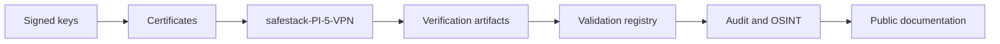

# SafeStack repository tree

Snapshot date: **2026-09-20**  
Organisation: [`kibernetinio-saugumo-sprendimai`](https://github.com/kibernetinio-saugumo-sprendimai)

```text
kibernetinio-saugumo-sprendimai/
├── Trust & registry
│   ├── Verification-artifacts            public  · external hash anchors
│   ├── safestack-project-public-keys     public  · signed public keys
│   ├── safestack-technical-canon         public  · technical canon
│   ├── safestack-validation-registry     public  · validation records
│   ├── safestack-control-architecture    public  · trust boundaries
│   ├── safestack-canon                   public  · archived trust anchors
│   └── safestack_registry                private · client/device registry
│
├── Runtime & infrastructure
│   ├── safestack-Pi-5-VPN                private · signed edge VPN device
│   ├── node-os                           public  · hardened Pi 5 node OS
│   ├── Safestack-Zero-Trust              public  · local-first policy engine
│   ├── SafeStack-Zero-Trust-Platform     public  · zero-trust platform
│   ├── Safestack-Sentinel                public  · security monitoring
│   ├── Safestack-suite                   public  · integrated runtime suite
│   └── safestack-sertifikatai            private · controlled certificates
│
├── Intelligence & automation
│   ├── safestack-audit_system            public  · deterministic audit engine
│   ├── safestack-OSINT                   public  · integrity-checked OSINT
│   ├── AI-Tyreju-Komanda                 public  · AI team tooling
│   └── telegram-ai-bot                   private · personal automation
│
├── Web & publishing
│   ├── freedom.manifesto.github.io       public  · public manifesto site
│   ├── safestack-porfolio.github.io      public  · portfolio site
│   └── .github                           public  · shared organisation config
│
└── Ecosystem & media
    ├── safestack-partners                public  · partner ecosystem
    ├── safestack-media-library            public  · visual asset library
    └── safestack-music                    public  · YouTube link catalogue
```

## Trust flow



The tree is an orientation model. Private repositories are shown by name and purpose only; their contents are not reproduced here.
