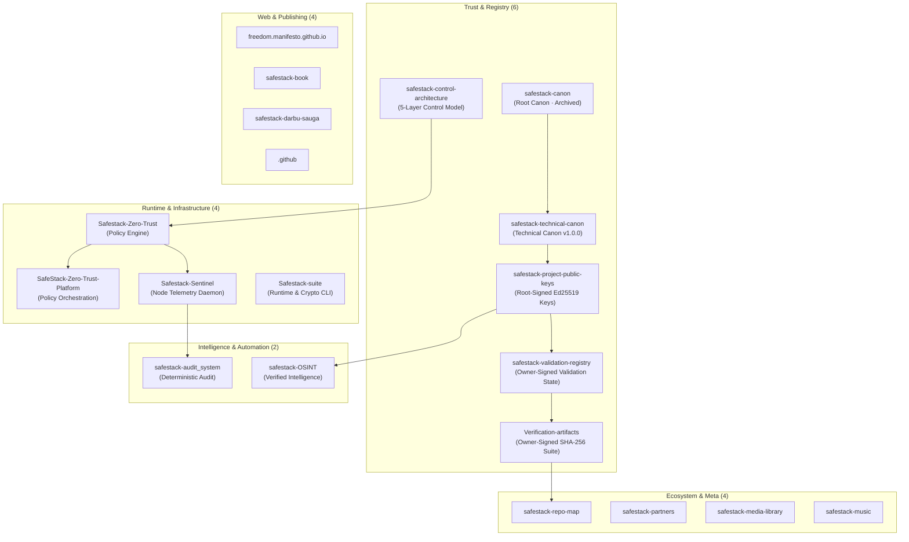

# SafeStack Public Repository Tree

Snapshot date: **2026-11-06**  
Organisation: [`kibernetinio-saugumo-sprendimai`](https://github.com/kibernetinio-saugumo-sprendimai)  
Scope: **20 Public Repositories Only** (Private and internal operational repositories strictly excluded)

```text
kibernetinio-saugumo-sprendimai/
├── Trust & registry (6)
│   ├── safestack-canon                   public · archived · canonical trust anchors & root philosophy
│   ├── safestack-technical-canon         public · active   · technical governance & manifest schemas
│   ├── safestack-project-public-keys     public · active   · root-signed Ed25519 project & release keys
│   ├── safestack-validation-registry     public · active   · formal validation records & owner-signed declarations
│   ├── Verification-artifacts            public · active   · detached owner-signed SHA-256 manifests & verifier
│   └── safestack-control-architecture    public · active   · 5-layer routing, encryption & trust boundaries
│
├── Runtime & infrastructure (4)
│   ├── Safestack-Zero-Trust              public · active   · local-first policy engine & posture gates
│   ├── SafeStack-Zero-Trust-Platform     public · active   · zero-trust platform & orchestration components
│   ├── Safestack-Sentinel                public · active   · continuous node monitoring & telemetry daemon
│   └── Safestack-suite                   public · active   · integrated runtime security & crypto tools
│
├── Intelligence & automation (2)
│   ├── safestack-audit_system            public · active   · deterministic AI-first security audit framework
│   └── safestack-OSINT                   public · active   · modular policy-driven OSINT with root verification
│
├── Web & publishing (4)
│   ├── freedom.manifesto.github.io       public · active   · public freedom manifesto & community documentation
│   ├── safestack-book                    public · active   · technical books, papers & documentation library
│   ├── safestack-darbu-sauga             public · active   · OHS / DSS workplace & remote ergonomics standard
│   └── .github                           public · active   · shared organisation profiles & workflow defaults
│
└── Ecosystem & meta (4)
    ├── safestack-repo-map                public · active   · visual architecture map & repository registry
    ├── safestack-partners                public · active   · partner ecosystem & security integrations
    ├── safestack-media-library           public · active   · visual assets, schematics & documentation media
    └── safestack-music                   public · active   · audio link catalogue & soundtrack archive
```

---

## Architectural Trust Flow



---

## Public Repository Catalogue

| Repository | Domain | Language / Format | Status | Primary Purpose |
| :--- | :--- | :--- | :--- | :--- |
| [**`safestack-canon`**](https://github.com/kibernetinio-saugumo-sprendimai/safestack-canon) | Trust & registry | Markdown / PGP | Archived | Immutable root trust anchors and canonical philosophy |
| [**`safestack-technical-canon`**](https://github.com/kibernetinio-saugumo-sprendimai/safestack-technical-canon) | Trust & registry | JSON / PGP | Active | Technical specifications, manifest schemas, and hash registry |
| [**`safestack-project-public-keys`**](https://github.com/kibernetinio-saugumo-sprendimai/safestack-project-public-keys) | Trust & registry | Python / Ed25519 | Active | Root-signed project public keys and release signer registry |
| [**`safestack-validation-registry`**](https://github.com/kibernetinio-saugumo-sprendimai/safestack-validation-registry) | Trust & registry | JSON / Ed25519 / PGP | Active | Formal registry of validated projects, audit records, and owner-signed declarations |
| [**`Verification-artifacts`**](https://github.com/kibernetinio-saugumo-sprendimai/Verification-artifacts) | Trust & registry | Python / Shell / SHA-256 | Active | Detached owner-signed SHA-256 checksum manifests and ecosystem verifier |
| [**`safestack-control-architecture`**](https://github.com/kibernetinio-saugumo-sprendimai/safestack-control-architecture) | Trust & registry | HTML / CSS | Active | Layered routing, encryption mechanisms, and infrastructure boundaries |
| [**`Safestack-Zero-Trust`**](https://github.com/kibernetinio-saugumo-sprendimai/Safestack-Zero-Trust) | Runtime & infra | Python | Active | Local-first zero-trust policy decision engine and posture gates |
| [**`SafeStack-Zero-Trust-Platform`**](https://github.com/kibernetinio-saugumo-sprendimai/SafeStack-Zero-Trust-Platform) | Runtime & infra | Python | Active | Zero-trust security platform and policy orchestration components |
| [**`Safestack-Sentinel`**](https://github.com/kibernetinio-saugumo-sprendimai/Safestack-Sentinel) | Runtime & infra | Python | Active | Continuous node security monitoring and telemetry daemon |
| [**`Safestack-suite`**](https://github.com/kibernetinio-saugumo-sprendimai/Safestack-suite) | Runtime & infra | Python | Active | Integrated runtime tools and cryptographic utility suite |
| [**`safestack-audit_system`**](https://github.com/kibernetinio-saugumo-sprendimai/safestack-audit_system) | Intelligence | Python | Active | Deterministic AI-first security audit engine and agent containment |
| [**`safestack-OSINT`**](https://github.com/kibernetinio-saugumo-sprendimai/safestack-OSINT) | Intelligence | Python | Active | Policy-driven OSINT framework with cryptographic integrity anchors |
| [**`freedom.manifesto.github.io`**](https://github.com/kibernetinio-saugumo-sprendimai/freedom.manifesto.github.io) | Web & publishing | HTML | Active | Public freedom manifesto portal and community documentation |
| [**`safestack-book`**](https://github.com/kibernetinio-saugumo-sprendimai/safestack-book) | Web & publishing | Markdown / Docs | Active | SafeStack technical documentation, books, and research papers |
| [**`safestack-darbu-sauga`**](https://github.com/kibernetinio-saugumo-sprendimai/safestack-darbu-sauga) | Web & publishing | Markdown / SVG | Active | Occupational health and safety (DSS) standard and ergonomics handbook (`HN 32:2004`) |
| [**`.github`**](https://github.com/kibernetinio-saugumo-sprendimai/.github) | Web & publishing | Markdown | Active | Shared organisation community profiles and workflow templates |
| [**`safestack-repo-map`**](https://github.com/kibernetinio-saugumo-sprendimai/safestack-repo-map) | Ecosystem & meta | SVG / JSON / Markdown | Active | Visual architecture map, tree index, and machine-readable snapshot |
| [**`safestack-partners`**](https://github.com/kibernetinio-saugumo-sprendimai/safestack-partners) | Ecosystem & meta | Markdown / SVG | Active | Ecosystem partners and security integration resources |
| [**`safestack-media-library`**](https://github.com/kibernetinio-saugumo-sprendimai/safestack-media-library) | Ecosystem & meta | Assets | Active | Curated visual asset library for schematics and documentation |
| [**`safestack-music`**](https://github.com/kibernetinio-saugumo-sprendimai/safestack-music) | Ecosystem & meta | Markdown / SVG | Active | Audio link catalogue and ecosystem soundtrack archive |
